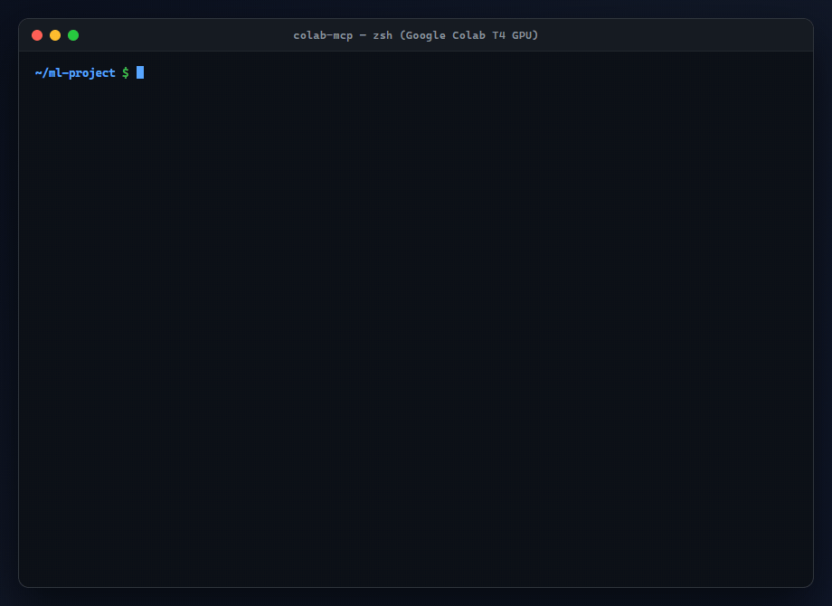

<!-- mcp-name: io.github.Treamyracle/colab-mcp -->

# Google Colab CLI & MCP Server (`colab-mcp`)

[](https://github.com/Treamyracle/colab-mcp/actions/workflows/ci.yml)
[](https://github.com/Treamyracle/colab-mcp/releases)
[](https://modelcontextprotocol.io/)
[](https://www.python.org/)
[](LICENSE)
[](https://github.com/Treamyracle/colab-mcp/stargazers)

A **full-parity CLI & Model Context Protocol (MCP) server** connecting your terminal and AI coding assistants (Claude Code, Claude Desktop, Cursor, Antigravity, VS Code, Windsurf) directly to **consumer Google Colab** (`colab.research.google.com`).

Authenticate with your Google account, provision CPU/GPU/TPU runtimes, execute Python snippets or full `.ipynb` Jupyter notebooks, handle `input()` / `userdata` / Drive seamlessly without browser popups, monitor GPU VRAM & system telemetry, transfer `.zip`/dataset files and Google Drive artifacts, and store encrypted tokens—from either the CLI or your AI agent.

---

## 🎬 Demo



> `colab-mcp connect-runtime --accelerator T4` → `colab-mcp execute-code` → `colab-mcp system-metrics` ([asciinema cast](docs/assets/demo.cast)).

---

## 🌟 Key Features

- **Consumer Colab Automation:** Connects directly to Google Colab's Tunnel Frontend (TFE) without requiring enterprise GCP / Vertex AI configurations.
- **Hardware Acceleration on Demand:** Provision and switch between standard CPU (`NONE`), NVIDIA GPUs (`T4`, `L4`, `A100`, `H100`), and Google Cloud TPUs (`V5E1`, `V6E1`). Supports High-RAM shapes (`~51 GB`) on Pro/Pro+ accounts.
- **Remote & Local Session Management:** List all active Colab VMs on your account (`colab_list_sessions`), re-attach to compatible sessions (`reuse_existing=True`) to avoid Free Tier HTTP 412 quota errors, or terminate specific/all sessions (`colab_disconnect_runtime`).
- **Multi-Account Support:** Switch accounts cleanly via `auth_user_index` (`?authuser=N` and `X-Goog-AuthUser: N`).
- **Zero-Friction Google Authentication:**
  - **OAuth 2.0 Remote Flow:** Copy-paste authorization code for headless, remote, and agent-driven setups.
  - **Local Loopback Flow:** Browser-based OAuth callback on `127.0.0.1`.
  - **Ambient ADC:** Reuses existing `gcloud auth application-default login` credentials.
  - **Chrome CDP Fallback:** Real Chrome login via Chrome DevTools Protocol with subprocess `DEVNULL` stdout isolation and `SAPISIDHASH` request signing.
- **OS-Native Keystore Storage:** Credentials are encrypted via Windows DPAPI, macOS Keychain, or Linux Secret Service (with an AES-256-GCM `0600` file fallback).
- **Keep-Alive Daemon & 30-Minute Watchdog:** Pings `/{endpoint}/keep-alive/` every 35s and automatically deallocates idle runtimes after 30 minutes of inactivity (skipping deallocation while a kernel is actively `busy`).
- **Jupyter Messaging Protocol v5.3 WebSocket Bridge:** Intermediate kernel discovery/creation (`/api/kernels`), RFC 6455 handshake (`subprotocols=None`, `compression=None`, `?session_id=`), chronological multimodal output capture (`TextContent` + `ImageContent`), ECMA-48 ANSI sanitization, head-tail output truncation, and non-destructive SIGINT / escalated kernel restart.
- **Complete `.ipynb` Notebook Engine:** Load, validate (`nbformat` v4), execute sequentially or by 0-based `cell_indices`, configure `stop_on_error` and `reset_kernel_before_run`, and persist executed outputs back to disk.
- **VM File Transfer & Google Drive Integration:** List, upload, and download binary files (such as exported `.zip` archives, datasets, and checkpoints) via Colab's Jupyter Contents API with automatic 512 KB chunked kernel streaming and SHA-256 verification for large/out-of-root files, plus Google Drive API v3 tools.
- **Dual Transports:** Standard I/O (`stdio`) with strict `stderr` log isolation, plus Server-Sent Events (`sse`).

---

## 🏗️ Architecture

```
+-----------------------------------------------------------------------------------------+
|                                    AI AGENT HOST                                        |
|             (Claude Desktop / Cursor / Antigravity / Windsurf / VS Code Cline)          |
+-----------------------------------------------------------------------------------------+
                                             |
                                             | MCP Protocol (JSON-RPC 2.0)
                                             v
+=========================================================================================+
|                              COLAB MCP SERVER ENGINE                                    |
|                                                                                         |
|  +-----------------------------+               +-------------------------------------+  |
|  |     stdio Transport         |               |       SSE Transport (HTTP)          |  |
|  |  - JSON-RPC over stdin/out  |               |  - GET /sse (Event Stream)          |  |
|  |  - Stderr logger isolation  |               |  - POST /messages (RPC Dispatch)    |  |
|  +-----------------------------+               +-------------------------------------+  |
|                 |                                                 |                     |
|                 +------------------------+------------------------+                     |
|                                          |                                              |
|                                          v                                              |
|  +-----------------------------------------------------------------------------------+  |
|  |                            MCPServer Tool Dispatcher                              |  |
|  |   - Pydantic v2 schema validation & Global Egress Credential Redaction            |  |
|  +-----------------------------------------------------------------------------------+  |
|       |                        |                        |                        |      |
|       v                        v                        v                        v      |
|  +------------+         +--------------+         +--------------+         +----------+  |
|  |   auth/    |         |   runtime/   |         |   kernel/    |         |  files/  |  |
|  | - OAuth2   |         | - TFE Client |         | - WS Client  |         | - VM I/O |  |
|  | - CDP      |         | - Sessions   |         | - Correlator |         | - Drive  |  |
|  | - Keystore |         | - KeepAlive  |         | - MIME/ANSI  |         | - Chunks |  |
|  +------------+         +--------------+         +--------------+         +----------+  |
+=========================================================================================+
         |                       |                        |                        |
         v                       v                        v                        v
+------------------+   +--------------------+   +-------------------+   +-----------------+
| Google Accounts  |   | Colab TFE Gateway  |   | Remote Colab VM   |   | Google Drive v3 |
| / OAuth 2.0      |   | (/tun/m/...)       |   | Jupyter Kernel    |   | API (Optional)  |
+------------------+   +--------------------+   +-------------------+   +-----------------+
```

For deep protocol details, see [docs/ARCHITECTURE.md](docs/ARCHITECTURE.md).

---

## 🚀 Installation & Quick Start

### 1. Install

Run via `uvx` or install via `pip` (PyPI package: [`gcolab-mcp`](https://pypi.org/project/gcolab-mcp/), exposes both `colab-mcp` and `gcolab-mcp` CLI commands):

```bash
# Run directly from PyPI with uvx (once v0.1.1+ is published)
uvx gcolab-mcp run

# Or install from PyPI via pip
pip install gcolab-mcp

# Or run directly from GitHub with uvx (no clone required)
uvx --from git+https://github.com/Treamyracle/colab-mcp.git colab-mcp run

# Or install editable for local development (with browser CDP + test dependencies)
git clone https://github.com/Treamyracle/colab-mcp.git
cd colab-mcp
pip install -e ".[all]"
playwright install chromium
```

### 2. Configure Your AI Agent Host

Auto-configure Claude Desktop, Claude Code, Cursor, Antigravity, or VS Code in one command:

```bash
colab-mcp setup-mcp --client auto
# Or target a specific client / preview changes first:
colab-mcp setup-mcp --client cursor --dry-run
```

Or configure manually:

#### Claude Desktop
Add `colab` to your `claude_desktop_config.json`:
- **macOS:** `~/Library/Application Support/Claude/claude_desktop_config.json`
- **Windows:** `%APPDATA%\Claude\claude_desktop_config.json`
- **Linux:** `~/.config/Claude/claude_desktop_config.json`

```json
{
  "mcpServers": {
    "colab": {
      "command": "uvx",
      "args": ["--from", "git+https://github.com/Treamyracle/colab-mcp.git", "colab-mcp", "run"]
    }
  }
}
```

Or using a local Python environment:

```json
{
  "mcpServers": {
    "colab": {
      "command": "python",
      "args": ["-m", "colab_mcp", "run", "--transport", "stdio"]
    }
  }
}
```

#### Cursor / Antigravity / Windsurf / Cline
Add an MCP server entry with:
- **Server Name:** `colab`
- **Transport:** `stdio`
- **Command:** `colab-mcp` (or `python`)
- **Arguments:** `["run"]` (or `["-m", "colab_mcp", "run"]`)

---

## 🔑 Authentication Guide

Authenticate once via your AI agent (`colab_login`) or from the CLI:

### Method A: Remote OAuth 2.0 Flow (Recommended for Agents & Headless CLI)
```bash
colab-mcp login --method oauth_remote
```
1. Open the generated Google consent URL in any browser and approve access.
2. Paste the authorization code back into the prompt (or pass `auth_code=...` to `colab_login`).
3. Tokens are encrypted and persisted in your OS keyring.

### Method B: Local Loopback OAuth (Desktop)
```bash
colab-mcp login --method oauth_loopback
```

### Method C: Ambient Application Default Credentials (ADC)
```bash
colab-mcp login --method oauth_adc
```

### Method D: Chrome CDP Browser Fallback
For Google Workspace accounts or environments where OAuth clients are restricted:
```bash
colab-mcp login --method cdp_browser
```
Opens a real Google Chrome window (`--remote-debugging-port=9222`) for interactive login and 2FA, then extracts and encrypts the session cookies (`SAPISID`, `SID`, `OSID`).

---

## 🛠️ Complete MCP Tool Reference

`colab-mcp` exposes **25 MCP tools** across four categories:

### 1. Authentication & Secrets Vault Tools (6)

| Tool Name | Key Parameters | Description |
|---|---|---|
| `colab_login` | `method`, `auth_user_index`, `auth_code`, `cookies`, `timeout_seconds` | Authenticate with Google Colab via OAuth 2.0 (`oauth_remote`, `oauth_loopback`, `oauth_adc`), `cdp_browser`, or `cookie_import`. |
| `colab_get_auth_status` | `auth_user_index` (default `0`), `force_refresh` (`false`) | Query active account email, token validity, Colab subscription tier, CCU balance, and active assignment count. |
| `colab_logout` | `auth_user_index` (default `0`), `terminate_active_runtimes` (`true`) | Purge stored credentials from the OS keystore and optionally terminate active runtimes. |
| `colab_set_secret` | `name`, `value`, `runtime_id` (optional) | Encrypt and store a token/secret (e.g. `HF_TOKEN`, `WANDB_API_KEY`) in the OS keyring vault, register it for egress redaction, and inject into `os.environ` & `google.colab.userdata`. |
| `colab_list_secrets` | *(none)* | List stored secret names and masked previews without exposing plaintext values. |
| `colab_delete_secret` | `name`, `runtime_id` (optional) | Remove a secret from the encrypted vault and unset it on any connected kernel. |

### 2. Runtime, Session & Telemetry Tools (6)

| Tool Name | Key Parameters | Description |
|---|---|---|
| `colab_list_runtime_types` | `auth_user_index` (default `0`) | Query live accelerator eligibility (`NONE`, `T4`, `L4`, `G4`, `A100`, `H100`, `V5E1`, `V6E1`), RAM shapes, and hourly CCU rates. |
| `colab_list_sessions` | `auth_user_index` (default `0`), `probe_kernels` (`true`) | List all active remote and locally tracked Colab VM sessions (including browser or prior-run sessions) with live kernel state. |
| `colab_connect_runtime` | `accelerator`, `high_ram`, `reuse_existing` (`true`), `auth_user_index`, `timeout_seconds` | Provision a new Colab VM or re-attach to an existing matching session and initialize keep-alive heartbeat. |
| `colab_get_runtime_status` | `runtime_id` (optional) | Inspect VM health, live kernel execution state, uptime, idle timer, and keep-alive status. |
| `colab_get_system_metrics` | `runtime_id` (optional) | Inspect live GPU VRAM usage, GPU utilization %, system RAM, and `/content` disk usage on the connected VM. |
| `colab_disconnect_runtime` | `runtime_id` (optional), `disconnect_all` (`false`), `auth_user_index` (`0`) | Terminate one local/remote Colab VM by `runtime_id` or all sessions (`disconnect_all=True`) via TFE `/unassign`. |

### 3. Code, Stdin & Notebook Execution Tools (6)

| Tool Name | Key Parameters | Description |
|---|---|---|
| `colab_execute_code` | `code`, `runtime_id`, `timeout_seconds`, `wait_for_completion`, `store_history`, `max_text_lines`, `max_output_bytes`, `max_images`, `stdin_inputs`, `env` | Execute Python code or IPython magic (`!nvidia-smi`, `%timeit`); returns chronological `TextContent` and `ImageContent` blocks. Supports `stdin_inputs` (`$SECRET:<NAME>` allowed) and `env` overrides. |
| `colab_execute_notebook` | `notebook_path` \| `notebook_content`, `reset_kernel_before_run`, `cell_indices`, `stop_on_error`, `timeout_per_cell_seconds`, `output_save_path`, `stdin_inputs`, `env` | Parse (`nbformat` v4) and execute `.ipynb` notebooks sequentially or selectively with headless Colab shims, diagnostics, and disk serialization. |
| `colab_get_execution_status` | `execution_id` | Poll execution progress, elapsed time, `waiting_for_input` prompt state, and partial stdout tail for async jobs. |
| `colab_get_cell_output` | `execution_id`, `include_images`, `max_text_lines`, `max_output_bytes`, `max_images` | Retrieve full buffered outputs in strict chronological emission order for an execution job. |
| `colab_send_input` | `execution_id`, `value` | Deliver a `stdin` reply (`$SECRET:<NAME>` supported) to an async execution blocked on `input()` or `getpass()`. |
| `colab_interrupt_execution` | `runtime_id` (optional) | Send non-destructive SIGINT first; escalates to kernel restart after 5.0s if unresponsive, reporting `state_reset` and `kernel_restarted`. |

### 4. VM File Transfer & Google Drive Tools (7)

| Tool Name | Key Parameters | Description |
|---|---|---|
| `colab_list_files` | `remote_path` (default `"/content"`), `runtime_id` (optional) | List files and directories on the connected Colab VM. |
| `colab_download_file` | `remote_path`, `local_path`, `runtime_id` (optional) | Download any file (e.g., exported `.zip`, CSV, checkpoint) from the Colab VM to local disk with SHA-256 verification and automatic chunked fallback for large files. |
| `colab_upload_file` | `local_path`, `remote_path`, `runtime_id` (optional) | Upload a local file (dataset, `.zip` bundle, script) onto the connected Colab VM. |
| `colab_delete_file` | `remote_path`, `recursive` (`false`), `runtime_id` (optional) | Delete a file or directory on the connected Colab VM (`recursive=true` for non-empty folders). |
| `colab_drive_list` | `folder` (default `"MyDrive"`), `query`, `max_results`, `auth_user_index`, `quota_project_id` | List files and folders in Google Drive via Drive API v3. |
| `colab_drive_download` | `file_id_or_path`, `local_path`, `runtime_path`, `auth_user_index`, `runtime_id`, `quota_project_id` | Download a file from Google Drive to local disk and/or directly onto the connected Colab VM. |
| `colab_drive_upload` | `local_path` \| `runtime_path`, `drive_folder`, `file_name`, `auth_user_index`, `runtime_id`, `quota_project_id` | Upload a file from local disk or directly from the Colab VM into Google Drive. |

> **Headless Colab Popup Handling:** `colab-mcp` automatically injects headless shims into connected kernels so `google.colab.userdata.get(...)`, `google.colab.auth.authenticate_user()`, `google.colab.files.upload()` / `files.download()`, and `google.colab.drive.mount('/content/drive')` (Option A: creates `/content/drive/MyDrive` workspace cleanly without blocking) work without browser UI modals. Use `colab_drive_upload` / `colab_drive_download` to sync files directly with Google Drive (requires `drive.googleapis.com` enabled on a `quota_project_id` / `COLAB_MCP_GCP_PROJECT` when using Google's public OAuth client; default `drive.file` scope covers app-uploaded files, while full-Drive listing uses a custom OAuth client in `~/.colabmcp/config.json`).

---

## 💻 CLI Reference (`colab-mcp`)

`colab-mcp` provides a **28-command CLI** alongside its 25-tool MCP server (including exclusive CLI `ssh`, `job`, and `runtime-url` workflows). Commands share an encrypted OS keystore and a token-free CLI session pointer (`~/.colabmcp/cli_session.json`), support human-readable tables by default with `--json` for scripts/agents, and return typed exit codes (`10` auth, `11` quota/capacity, `12` disconnected, `13` execution error).

### Quick CLI Workflow

```bash
# 1. Authenticate and connect a GPU runtime
colab-mcp login --method oauth_remote
colab-mcp connect-runtime --accelerator T4

# 2. Run code, save Matplotlib plots, inspect GPU VRAM, execute notebooks
colab-mcp execute-code "import torch; print(torch.cuda.get_device_name(0))"
colab-mcp execute-code --file train.py --save-images-dir ./plots
colab-mcp system-metrics
colab-mcp execute-notebook experiment.ipynb --output-save-path executed.ipynb

# 3. Transfer files, attach browser UI, SSH, or run ephemeral shebang jobs
colab-mcp download-file /content/model.pt ./model.pt
colab-mcp runtime-url --open
colab-mcp ssh -- nvidia-smi
colab-mcp disconnect

# Fire-and-forget GPU script (auto-disconnects in finally, propagates exit code):
colab-mcp job --accelerator T4 train.py --epochs 10

# Print ~/.ssh/config snippet for VS Code / Cursor Remote-SSH:
colab-mcp ssh --ssh-config --accelerator T4 --rm

# Auto-configure Claude Desktop, Claude Code, Cursor, Antigravity, or VS Code MCP config:
colab-mcp setup-mcp --client cursor
```

### Complete Command Catalog (28 Commands)

| Category | Command | Description |
|---|---|---|
| **Server & Setup** | `run` | Start the MCP server (`stdio` or `sse` with `--host` and `--port`). |
| | `setup-mcp` | Auto-configure `colab-mcp` in Claude Desktop, Claude Code, Cursor, Antigravity, or VS Code (`--dry-run`, `--remove`). |
| | `version` | Print the installed `colab-mcp` version (`--json`). |
| **Auth & Secrets** | `login` | Authenticate a Google account (`oauth_remote`, `oauth_loopback`, `oauth_adc`, `cdp_browser`, `cookie_import`). |
| | `status` | Show authentication status, tier, CCU balance, and active runtime state. |
| | `logout` | Terminate active sessions and purge stored credentials. |
| | `set-secret` | Encrypt and store a token/secret in the vault via hidden prompt or `--value`. |
| | `list-secrets` | List stored secret names and masked previews. |
| | `delete-secret` | Remove a stored secret/token from the vault. |
| **Runtime & Telemetry** | `list-runtimes` | List available hardware accelerators (`NONE`, `T4`, `L4`, `G4`, `A100`, `H100`, `V5E1`, `V6E1`) and hourly CCU rates. |
| | `list-sessions` | List all active remote and locally tracked Colab sessions. |
| | `connect-runtime` | Provision or attach a Colab VM (`--accelerator T4`, `--high-ram`) and save the active CLI session. |
| | `runtime-status` | Inspect active VM health, kernel execution state, and uptime. |
| | `runtime-url` | Print (or `--open`) a Colab browser UI link attached directly to the active runtime. |
| | `system-metrics` | Show live GPU VRAM/utilization, system RAM, and `/content` disk usage. |
| | `disconnect` | Terminate the active session, a target `--runtime-id`, or all sessions (`--all`). |
| **Code & Notebooks** | `execute-code` | Execute inline code, `--file`, or `-` (stdin); supports `--stdin-input`, `--env`, `--save-images-dir`, `--non-interactive`. |
| | `job` | Provision an ephemeral VM, run `SCRIPT [ARGS...]` (`__main__`, shebang, exit-code propagation), and auto-disconnect (`--keep` to preserve). |
| | `execute-notebook` | Execute `.ipynb` notebooks cell-by-cell (`--cell-index`, `--no-reset-kernel`, `--output-save-path`). |
| | `interrupt` | Send SIGINT (escalating to kernel restart if hung) to the active kernel. |
| **VM Files & Drive** | `list-files` | List files and directories on the connected Colab VM (default `/content`). |
| | `upload-file` | Upload a local file to the Colab VM with SHA-256 verification. |
| | `download-file` | Download any file from the Colab VM to local disk (with chunked fallback). |
| | `delete-file` | Delete a remote file or directory (`--recursive`) on the Colab VM. |
| | `drive-list` | List files and folders in Google Drive via Drive API v3. |
| | `drive-download` | Download a Google Drive file to `--local-path` and/or `--runtime-path`. |
| | `drive-upload` | Upload from `--local-path` or `--runtime-path` directly to Google Drive. |
| **Remote SSH** | `ssh` | WebSocket SSH (`/colab/ssh`, when exposed by the runtime proxy; returns HTTP `404` otherwise): interactive shell, OpenSSH `--proxy-mode`, `-- CMD` one-shots, `--rm`, `--force`, `--ssh-config`. |

### Exit Codes

| Code | Meaning |
|---|---|
| `0` | Success |
| `1` | Unexpected error |
| `2` | Invalid arguments / validation error |
| `10` | Authentication required or keystore error |
| `11` | Quota exceeded, High-RAM unavailable, or cloud capacity error |
| `12` | Runtime disconnected / kernel unavailable |
| `13` | Kernel execution error, timeout, or unfulfilled `input()` under `--non-interactive` |

---

## ⚡ Hardware Accelerators & Pricing

| Accelerator ID | Hardware Device | VRAM / HBM | High-RAM (~51 GB) | Free Tier | Approx. Cost |
|---|---|---|---|---|---|
| `NONE` | 2 vCPU Intel Xeon | None | Pro/Pro+ only | Yes | 0.00 CCU/hr |
| `T4` | NVIDIA Tesla T4 | 16 GB GDDR6 | Pro/Pro+ only | Yes (Dynamic) | ~1.96 CCU/hr |
| `L4` | NVIDIA L4 Tensor Core | 24 GB GDDR6 | Supported | Pro/Pro+ | ~3.84 CCU/hr |
| `G4` | NVIDIA RTX PRO 6000 | 96 GB GDDR7 | Supported | Pro/Pro+ | ~6.70 CCU/hr |
| `A100` | NVIDIA A100-SXM4 | 40 GB / 80 GB | Supported | Pro/Pro+ | ~5.42 - 11.2 CCU/hr |
| `H100` | NVIDIA H100-SXM5 | 80 GB HBM3 | Supported | Pro+ | ~13.50 CCU/hr |
| `V5E1` | Cloud TPU v5e | 16 GB HBM | Standard Shape | Pro/Pro+ | ~1.96 CCU/hr |
| `V6E1` | Cloud TPU v6e | 32 GB HBM | Standard Shape | Pro+ | ~4.50 CCU/hr |

---

## 🛡️ Security Architecture

1. **Credential Isolation & Egress Redaction:** OAuth tokens (`ya29...`, `1//0...`), cookies (`SAPISID`, `OSID`, `SID`), and `SAPISIDHASH` signatures are stripped by a global egress redaction filter before reaching LLM context or logs.
2. **Encrypted Keystore:** Secrets use OS-native vaults (Windows DPAPI, macOS Keychain, Linux Secret Service) with an AES-256-GCM encrypted file fallback (`0600`).
3. **Cloud Execution Boundary:** All Python/notebook code executes inside Google's Colab containers—not on your local host.
4. **Compute Unit Watchdog:** Background 30-minute inactivity auto-unassign protects paid CCUs while preserving active `busy` training jobs.
5. **Path & Terminal Hardening:** Path traversal guards protect local and remote file operations, and ECMA-48 ANSI stripping sanitizes kernel tracebacks.

---

## 🤝 Contributing & Community

Contributions, bug reports, feature ideas, and pull requests are very welcome!

- **Star & Fork** the repository if `colab-mcp` saves you time running GPU/TPU workloads!
- Browse open issues (including [`good first issue`](https://github.com/Treamyracle/colab-mcp/labels/good%20first%20issue)) or start a conversation in [GitHub Discussions](https://github.com/Treamyracle/colab-mcp/discussions).
- Read [CONTRIBUTING.md](CONTRIBUTING.md) before opening a pull request.

```bash
# Run offline unit, integration, and ColabTwin opaque E2E suites (no Google login required)
pytest tests/unit/ tests/integration/ tests/e2e/opaque/ -q
```

- [Architecture Reference](docs/ARCHITECTURE.md)
- [Contributing Guide](CONTRIBUTING.md)
- [Security Policy](SECURITY.md)
- [Changelog](CHANGELOG.md)

---

## 📄 License

Apache License 2.0. See [LICENSE](LICENSE) for details.
